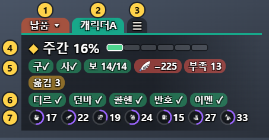
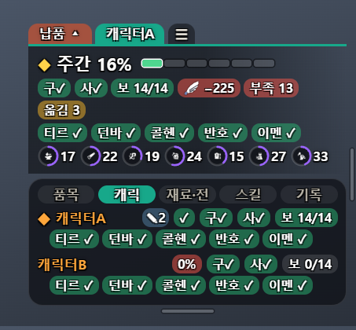
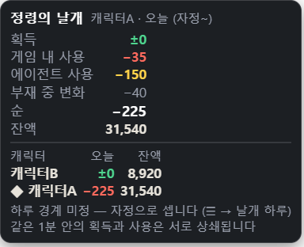
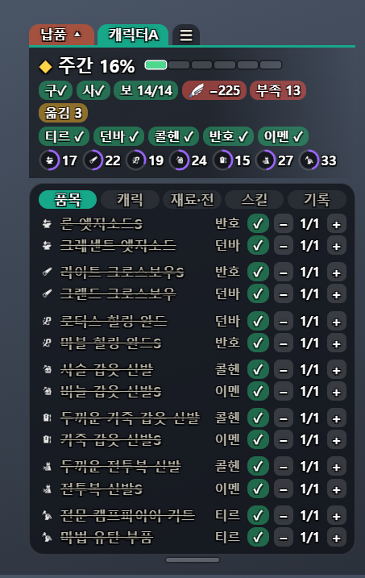
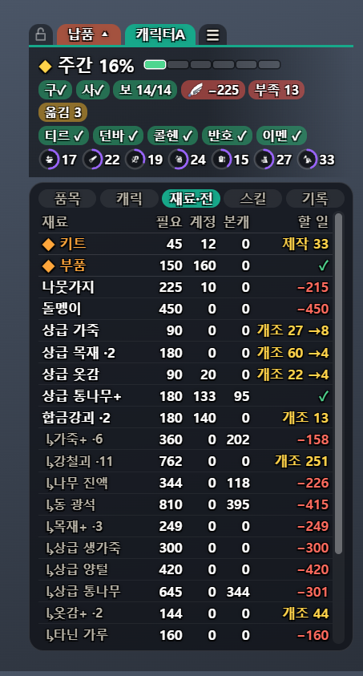
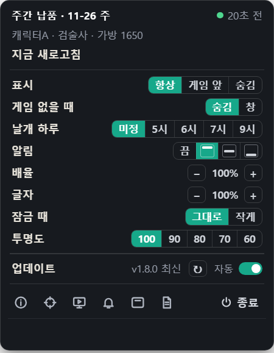
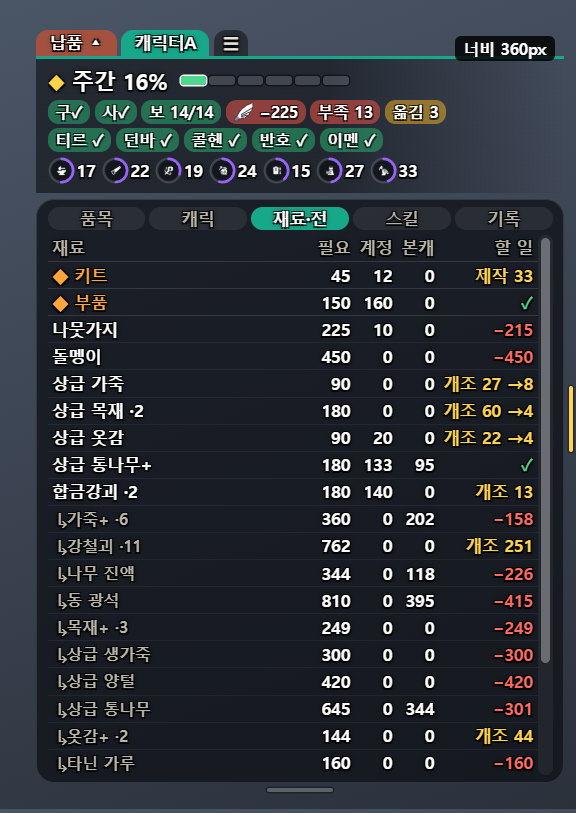
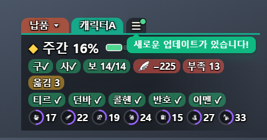

# 주간 납품 위젯 (마비노기 모바일, 비공식)

임무 게시판의 **주간 납품 스크롤**(제작 스크롤) 진행을 게임 창 위에 겹쳐 보여 주는 오버레이입니다.
여러 캐릭터가 매주 스크롤을 사서 퀘스트를 하는 경우, 누가 어디까지 했는지·무엇이 모자라는지를 한눈에 봅니다.

- 6캐릭터(설정 가능) 전체의 **주간 완료율** — 보고한 퀘스트 기준
- 캐릭터별 스크롤 **구매·사용** (전제 조건), **마을별** 구매 현황
- 남은 퀘스트에 필요한 **재료** — 접속 캐릭터 기준 / 전체 기준(본캐가 캘 것·계정 창고로 옮길 것)
- 생활 스킬 레벨·경험치, 접속 캐릭터의 **정령의 날개** 오늘 증감
- 게임 창이 없으면 트레이로 숨거나 일반 창으로 바뀜(☰ → 게임 없을 때)

## 원칙

- **게임에는 무료 조회 명령만 보냅니다.** 허용 목록은 `game.py`의 `FREE_READS`이고, 그 밖의 명령(특히 정령의 날개를 쓰는 `execute_*`)은 코드에서 거부합니다.
- 게임의 키보드 포커스를 가져가지 않고, 클릭은 게임으로 통과합니다(버튼·배지 위에서만 클릭을 받음).
- 게임 파일·메모리·통신은 건드리지 않습니다. 게임이 제공하는 AI 에이전트 CLI로 조회만 합니다.

## 필요한 것

- Windows, 마비노기 모바일 PC 클라이언트 실행 중 + 게임 설정 **"MM AI 에이전트 활성화"** 켜짐
- `MabinogiMobile_CLI.exe` — `C:`~`F:` 드라이브의 `Program Files (x86)\MabinogiMobile\`에서 찾습니다. 다른 곳이면 PATH에 두거나 환경 변수 `MOBINGI_CLI`로 경로 지정
- Python 3.10 이상, Node.js(npm) — 첫 실행 때 Electron을 설치합니다

## 실행

[최신 처음 설치 파일](https://github.com/mobingi-widgets/scroll-widget/releases/latest/download/scroll-widget-full.zip)을 받아 아무 폴더에 풀고
`주간 납품 위젯.bat`을 더블 클릭합니다([릴리스 페이지](https://github.com/mobingi-widgets/scroll-widget/releases/latest)). 첫 실행은 Electron 설치로 조금 걸립니다. 릴리스의 다른 파일은 앱이 업데이트할 때 씁니다.
처음 실행하면 **이용 안내**(하는 일 · 읽는 것 · 남기는 것 · 접속하는 곳)가 뜹니다. **동의하고 시작**을 눌러야 위젯이 시작하고
(게임 조회도 그때부터), 동의하지 않으면 아무것도 하지 않고 끝납니다. ☰ → ⓘ 이용 안내 보기로 다시 볼 수 있습니다.
끄기는 위젯의 **☰ → 종료** 또는 작업 표시줄 트레이 아이콘 우클릭.

- 게임 창이 없을 때는 ☰ → 게임 없을 때 `[숨김 | 창]`(처음엔 숨김).
  - 숨김: 게임을 끄면 3초 뒤 트레이 아이콘으로 숨고, 게임이 켜지면 게임 창 위로 돌아옵니다. 숨은 동안은 게임 조회를 쉬고, 돌아오면 바로 읽습니다.
  - 창: 일반 창으로 바뀌고, 게임이 켜지면 게임 창 위로 옮겨 붙습니다.
  - 게임 없이 직접 실행하면 어느 쪽이든 일반 창으로 뜹니다.
- 트레이 아이콘: 회색 = 숨김(게임이 없어 숨은 것도) · 빨간 점 = 문제. 누르면 보이기 / 숨기기.

### 부팅 시 자동 실행

- ☰ 맨 아래 아이콘(모니터 그림) — `네` / `아니오`, 처음엔 아니오. 켜져 있으면 그림이 초록색입니다.
- 켜면 Windows에 로그인할 때 위젯이 숨은 채 시작하고, 게임이 켜지면 나타납니다(게임 없을 때 = 숨김일 때).
- Windows 설정 → 앱 → 시작 앱(또는 작업 관리자 → 시작 앱)에서도 끌 수 있습니다. 그러면 메뉴에 `Windows 설정에서 꺼짐`으로 나옵니다.
- 폴더를 옮기면 다음 실행 때 새 자리로 다시 등록합니다.
- **폴더를 지우기 전에 끄세요.** 압축을 풀어 쓰는 프로그램이라 제거 프로그램이 없습니다. 남은 항목은 해가 없지만 시작 앱 목록에 남습니다.

## 화면



<sub>그림의 캐릭터 이름은 설명용으로 바꾼 것입니다.</sub>

| | |
|---|---|
| ① | `납품 ▾` — 누르면 아래 목록 펼치기 / 접기 |
| ② | 접속 중인 캐릭터 — 누르면 이름 붙이기 · 바꾸기 |
| ③ | ☰ — 누르면 메뉴, 끌면 위치 옮기기. 문제가 있으면 빨간 ⚠, 새 버전이 있으면 초록 점 |
| ④ | 이번 주 전체 완료율과 캐릭터별 칸 (모두 보고하면 100%) |
| ⑤ | 상태 배지 — 구매 · 사용 · 보고 수, 정령의 날개 오늘 증감, 재료 부족 · 창고로 옮길 것 |
| ⑥ | 스크롤을 파는 마을별 진행 |
| ⑦ | 생활 스킬 레벨과 경험치 고리 |

 

 



- 배지·칸에 마우스를 올리면 자세한 수치가 뜹니다. 잠시 더 두면 더 자세히.
- 재료 탭은 열린 상태에서 다시 누르면 전체(`전`) ↔ 접속 캐릭터(`나`).

## 캐릭터 인식

게임은 캐릭터 이름을 알려 주지 않아서 **가방 최대 무게 + 전투 직업**으로 캐릭터를 구분합니다.
처음 보는 캐릭터는 자동으로 추가되고, 위쪽 캐릭터 탭을 눌러 이름을 붙입니다.
가방을 늘리거나 직업을 바꾸면 "처음 보는 캐릭터"로 물어보니, 기존 캐릭터를 고르면 기록이 합쳐집니다.

## 게시판 보고

게임은 "보고했는지"를 알려 주지 않습니다. 다 모은 퀘스트가 트래커에서 사라지면 위젯이 "보고?"를 묻고,
품목 탭의 `+`로도 기록합니다.

## ☰ 메뉴

- 메뉴 밖을 한 번 누르면 메뉴만 닫힙니다. 줄에 마우스를 올리면 맨 아래에 설명.
- **맨 위 줄** — 마지막 갱신 뒤 지난 시간. 초록 점 = 정상 · 빨간 점 = 문제 · 회색 = 읽는 중. 마우스를 올리면 기록 저장 시각.
- 그 아래 접속 중인 캐릭터 · 직업 · 가방 최대 무게.
- **지금 새로고침** — 진행과 결과를 알림 한 줄로 보여 줍니다.
- **게임 없을 때** — [숨김 | 창]. 게임 창을 찾지 못할 때 트레이로 숨을지, 일반 창으로 보일지. 게임이 켜지거나 꺼지는 순간에만 적용합니다.
- **날개 하루** — 날개 증감의 하루 경계(게임 일일 초기화 시각).
- **알림** — 끔, 또는 뜨는 자리(위 · 가운데 · 아래). 게임 창이 내려가 있는 동안 온 것은 돌아오면 한 줄로 모아 보여 줍니다. 누르면 닫힙니다(뜬 직후 0.2초는 클릭이 게임으로).
- **맨 아래 아이콘** — 이용 안내 보기 · 위치 초기화 · 부팅 시 자동 실행 · 알림 등급(누를 때마다 모두 → 주의 → 행동) · 시험 알림 · 레시피 다시 읽기. 오른쪽 끝 종료.
- 트레이 아이콘 우클릭도 같은 메뉴입니다.

## 크기 · 위치



- 오버레이는 정해 둔 **영역** 안에 그려집니다. 내용이 늘거나 줄어도 영역은 그대로이고, 넘치면 스크롤. 빈 곳은 클릭이 게임으로 갑니다.
- 내용에 마우스를 올리면 영역 테두리(흐린 점선)와 높이·너비 막대가 나타납니다.
- **높이** — 영역 끝 선을 끕니다. 두 번 클릭하면 게임 창 끝까지.
- **너비** — 영역 옆 세로 선을 끕니다. 게임 창 가장자리에 붙지 않은 영역은 양쪽 모두. 두 번 클릭하면 기본 너비.
- **배율** — ☰ → 배율 `[−] 100% [+]` (70~150%). 위젯·메뉴·말풍선 전체 크기입니다.
- **글자** — ☰ → 글자 `[−] 100% [+]` (80~150%). 위젯·툴팁의 글자만 커지고, 그만큼 줄이 높아집니다.
- **자동 잠금** — 머리줄 맨 앞 자물쇠 단추. 켜 두면 위젯 밖으로 나가고 3초 뒤 흐려지고 마우스가 통과합니다. 위젯 위에서 마우스를 흔들면 풀립니다(트레이 메뉴 `잠금 해제`도). ☰ → 잠금 때 `작게`면 잠긴 동안 가장 작게 줄어듭니다.
- **위치** — ☰를 끌어 옮깁니다.
  - 게임 창 가장자리에 붙고, 다른 오버레이(망호 스캐너)는 피합니다.
  - 위 가장자리에 붙이면 아래로, 아래 가장자리에 붙이면 위로 펼칩니다(알약이 아래, 띠와 목록이 위). 붙이지 않으면 가까운 쪽.
  - 게임 창을 옮겨도 따라갑니다.
  - ☰ → 위치 초기화로 기본 자리.

## 스킬 아이콘

게임 그림은 들어 있지 않습니다(없으면 스킬 첫 글자로 표시). 게임의 **생활 스킬** 화면을 캡처해
`python icons/extract_glyphs.py <캡처.png> icons` 로 직접 만들 수 있습니다. 좌표는 게임 창 1300×1020 기준이라
창 크기가 다르면 `extract_glyphs.py`의 `CELLS`를 맞춰 주세요.

## 데이터

개인 데이터는 프로그램 폴더 밖(또는 `data/`)에 둡니다 — `paths.py` 참고. 이 폴더를 그대로 남에게 줘도 됩니다.
찾는 순서: 환경 변수 `MOBINGI_WIDGET_DATA` → `%APPDATA%\mobingi-scroll-widget\data-dir.txt`에 적힌 폴더(한 줄; 설치본이 다른 곳의
기록을 계속 쓰게 할 때 — 업데이트해도 유지) → 작업 공간 안이면 `runs/` → 프로그램 폴더의 `data/`.

| 파일 | 내용 |
|---|---|
| `catalog.json` (프로그램) | 납품 품목 카탈로그 — 게임 데이터, 개인 정보 없음 |
| `weekly_scrolls.json` | 캐릭터별 주간 기록 (형식 v2) |
| `weekly_scrolls_widget.json` | 생활 스킬 경험치 누적 |
| `wings_daily.json` | 캐릭터별 정령의 날개 일별 증감 |
| `widget_edits.jsonl` | 에이전트가 손으로 고친 기록 (undo용) |
| `widget_notify.jsonl` | 알림 대기열 |
| `loot_<아이템>.jsonl` | (있으면 읽기만) 던전 판별 수확 기록 |

## 에이전트 창구 (`widget.py`)

AI 에이전트가 사용자와 같이 일하면서 위젯이 놓친 기록을 고치거나 알림을 띄우는 명령줄 도구입니다. 게임은 부르지 않습니다.

```
python widget.py commands            # 명령 목록
python widget.py doc <명령>          # 한 명령의 설명
python widget.py status              # 요약
python widget.py set <캐릭터> <품목> <bought|used|reported> <n> --by <이름>
python widget.py notify "문장" --level info|warn|action
python widget.py catalog             # 품목 카탈로그 보기 / item·remove·not-storable·town-abbr 로 고치기
python widget.py undo                # 마지막 손 보정 되돌리기
```

## 업데이트



- 켤 때와 6시간마다 [GitHub 릴리스](https://github.com/mobingi-widgets/scroll-widget/releases)를 확인합니다.
- ☰ → 업데이트 줄: ↻ 지금 확인 · `자동` 끄기. 새 버전이면 버전 옆 초록 점, 누르면 업데이트 창.
- 새 버전이 있으면 ☰ 아래에 **새로운 업데이트가 있습니다!** 말풍선이 뜹니다. 누르면 업데이트 창.
- 스스로 설치하거나 재시작하지 않습니다.
- 원래 주소에 릴리스가 없으면 서명된 안내판(`mobingi-widgets/feeds`)에서 새 주소를 찾습니다.
- 업데이트를 누르면 받기 → 서명 확인 → 설치 → 다시 시작합니다.
- 이용 안내가 바뀐 버전이면 먼저 다시 묻습니다. 동의하지 않으면 지금 버전을 그대로 씁니다.
- 서명을 확인한 파일만 설치합니다(프로그램에 든 공개키 · minisign).
- `node_modules` · `data/` · `icons/`와 기록은 그대로 둡니다.
- 새 버전이 1분 안에 정상으로 뜨지 않으면 되돌립니다(프로그램 폴더 옆 `.scroll-widget-update\previous`).
- 교체 스크립트가 시작된 것을 확인한 뒤에만 위젯이 꺼집니다. 시작되지 않으면 지금 버전 그대로 실패를 알립니다.
- Electron이 바뀌는 버전은 릴리스 페이지에서 새로 받습니다.
- git으로 받은 폴더는 알려 주기만 합니다.
- 앱 안 업데이트가 안 되는 옛 판(1.4.1 이하)은 ☰ → 종료 후 `full.zip`을 같은 폴더에 덮어 풉니다. 기록(`data/`)은 그대로 남습니다.

## 버전

`CHANGELOG.md` — 프로그램 버전과 데이터 형식 변경 이력.
